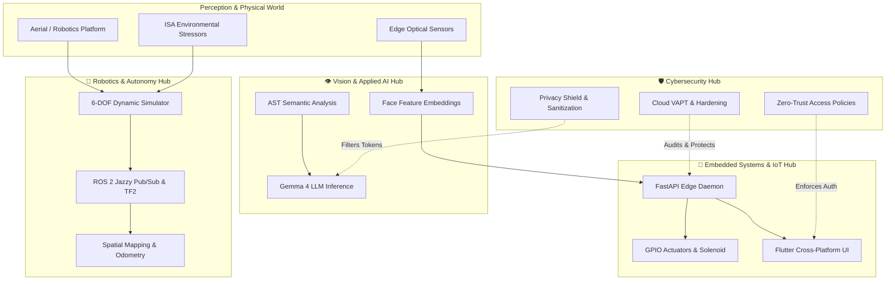

# Neo-0013 | Autonomous Systems & Applied Intelligence

<div align="center">

[](https://github.com/Neo-0013)
[](https://github.com/Neo-0013)
[](https://opensource.org/licenses/MIT)
[](https://docs.ros.org/en/jazzy/)
[](https://pytorch.org/)
[](https://isocpp.org/)
[](https://python.org/)

**Engineering Rigorous Autonomous Systems • Embedded Edge Intelligence • Resilient Cyber-Physical Defense**

[Overview](#-executive-summary) •
[Domain Hubs](#-four-domain-architecture) •
[System Synergy](#-cross-domain-synergy-matrix) •
[Mathematical Foundations](#-mathematical--computational-foundations) •
[Hardware & Stacks](#-hardware--software-matrix) •
[Contact](#-connect--collaborate)

</div>

---

## ⚡ Executive Summary

I build **mission-critical autonomous software and cyber-physical systems** where deterministic execution, mathematical modeling, and defense-in-depth security converge. My technical output spans:

- **Robotics & Dynamics**: 6-DOF aerial flight kinematics, Rankine-Froude momentum aerodynamics, and distributed ROS 2 Jazzy middleware.
- **Vision & Applied Deep Learning**: Edge facial recognition biometric pipelines and LLM AST-driven reasoning agents (Gemma 4).
- **Embedded & Edge IoT**: Hardware-abstracted sensor drivers, real-time WebSocket daemons, and cross-platform client telemetry.
- **Cybersecurity & Systems Hardening**: Cloud staging VAPT, defensive posture auditing, attack surface reduction, and policy enforcement.

---

## 🏛️ Four-Domain Architecture

To eliminate scattered repositories and present a coherent engineering narrative, my portfolio is structured into **four specialized domain hubs** powered by **Git Submodules**.

<table>
  <tr>
    <td width="50%" valign="top">
      <h3>🤖 <a href="https://github.com/Neo-0013/robotics-hub">Robotics & Autonomous Systems Hub</a></h3>
      <p><em>Aerial simulation, multi-body kinematics, and real-time ROS 2 middleware.</em></p>
      <ul>
        <li><b><a href="https://github.com/Neo-0013/uav-endurance-simulation">uav-endurance-simulation</a></b>: Dual-window PyQt6 GCS + Panda3D 3D simulator modeling momentum theory, ISA atmosphere scaling, and 6-DOF dynamics.</li>
        <li><b><a href="https://github.com/Neo-0013/ros2-jazzy-lab-experiments">ros2-jazzy-lab-experiments</a></b>: End-to-end ROS 2 Jazzy labs: Gazebo Sim, URDF, TF2 transforms, SLAM, and DDS pub/sub.</li>
        <li><b><a href="https://github.com/Neo-0013/ros2-cpp-learning">ros2-cpp-learning</a></b>: Low-overhead C++20 nodes, custom executors, service clients, and lifecycle nodes.</li>
      </ul>
      <p><b>Keywords:</b> <code>ROS 2 Jazzy</code> • <code>Panda3D</code> • <code>PyQt6</code> • <code>6-DOF Dynamics</code> • <code>C++20</code></p>
      <a href="https://github.com/Neo-0013/robotics-hub"><b>Explore Robotics Hub →</b></a>
    </td>
    <td width="50%" valign="top">
      <h3>👁️ <a href="https://github.com/Neo-0013/vision-ai-hub">Vision & Deep Learning / AI Hub</a></h3>
      <p><em>Localized neural inference, computer vision pipelines, and LLM reasoning.</em></p>
      <ul>
        <li><b><a href="https://github.com/Neo-0013/diff-whisperer">diff-whisperer</a></b>: CLI reasoning agent leveraging Gemma 4 to distill cryptic git diffs into high-level architectural insights with built-in Privacy Shield.</li>
        <li><b><a href="https://github.com/Neo-0013/zero-to-mastery-ml">zero-to-mastery-ml</a></b>: Production-grade computer vision, convolutional networks, transfer learning, and deep learning pipelines.</li>
        <li><b>Biometric Vision Core</b>: Multi-stage facial landmark extraction and Cosine-metric verification engine.</li>
      </ul>
      <p><b>Keywords:</b> <code>PyTorch</code> • <code>Gemma 4</code> • <code>OpenCV</code> • <code>AST Parsing</code> • <code>HuggingFace</code></p>
      <a href="https://github.com/Neo-0013/vision-ai-hub"><b>Explore Vision AI Hub →</b></a>
    </td>
  </tr>
  <tr>
    <td width="50%" valign="top">
      <h3>🔌 <a href="https://github.com/Neo-0013/embedded-iot-hub">Embedded Systems & IoT Hub</a></h3>
      <p><em>Edge hardware daemons, physical access controllers, and telemetry.</em></p>
      <ul>
        <li><b><a href="https://github.com/Neo-0013/smart-door-system">smart-door-system</a></b>: Distributed edge biometric entry platform combining a Flutter mobile/web dashboard, FastAPI asynchronous edge daemon, and GPIO door actuator.</li>
        <li><b>Edge Camera Watcher</b>: Real-time video ingestion pipeline with low-overhead frame-skipping and edge caching.</li>
        <li><b>Hardware Abstraction</b>: Microcontroller interfacing, relay triggers, and state-machine resilience.</li>
      </ul>
      <p><b>Keywords:</b> <code>Dart / Flutter</code> • <code>FastAPI</code> • <code>WebSockets</code> • <code>GPIO</code> • <code>Edge Daemons</code></p>
      <a href="https://github.com/Neo-0013/embedded-iot-hub"><b>Explore Embedded IoT Hub →</b></a>
    </td>
    <td width="50%" valign="top">
      <h3>🛡️ <a href="https://github.com/Neo-0013/cybersec-hub">Cybersecurity & Systems Defense Hub</a></h3>
      <p><em>Vulnerability assessment, cloud staging defense, and security automation.</em></p>
      <ul>
        <li><b><a href="https://github.com/Neo-0013/UNLOX-Projects">UNLOX-Projects</a></b>: Comprehensive offensive and defensive security operations: Cloud Staging VAPT, policy audits, network reconnaissance, and remediation.</li>
        <li><b>Automated Security Auditing</b>: Bash and Python tooling for Linux CIS hardening and privilege boundary verification.</li>
        <li><b>Data Privacy Engineering</b>: Sanitization filters and AST token masking for sensitive production payloads.</li>
      </ul>
      <p><b>Keywords:</b> <code>Cloud VAPT</code> • <code>OWASP Top 10</code> • <code>Linux Hardening</code> • <code>Network Auditing</code> • <code>MITRE ATT&CK</code></p>
      <a href="https://github.com/Neo-0013/cybersec-hub"><b>Explore Cybersecurity Hub →</b></a>
    </td>
  </tr>
</table>

### 🛠️ Systems & Foundations Layer
Behind the four research hubs lies rigorous core engineering across algorithms and web architecture:
- **[Focus-Flow](https://github.com/Neo-0013/Focus-Flow)**: Production productivity web platform (TypeScript, React, Vite, TailwindCSS) with offline-first synchronization.
- **[Python](https://github.com/Neo-0013/Python)**: Comprehensive algorithmic suite: Data Structures & Algorithms (DSA), design patterns, and asymptotic complexity analysis.
- **[Web Architecture](https://github.com/Neo-0013/web-development)** & **[HTML Basics](https://github.com/Neo-0013/HTML-BASICS)**: Core web standards, semantic markup, and client-server communication.

---

## 🔄 Cross-Domain Synergy Matrix

The real power of this portfolio lies in how these systems intersect in cyber-physical environments:



---

## 📐 Mathematical & Computational Foundations

My projects are rooted in formal physical and mathematical models:

### 1. Aerial Rotor Dynamics & Aerodynamic Power
Modeled in [`uav-endurance-simulation`](https://github.com/Neo-0013/uav-endurance-simulation) using **Rankine-Froude Momentum Theory**:

$$T = 2 \rho A v_i^2 \implies v_i = \sqrt{\frac{T}{2 \rho A}}$$

$$P_{\text{induced}} = T \cdot v_i = \frac{T^{3/2}}{\sqrt{2 \rho A}}, \quad P_{\text{profile}} = \frac{1}{8} \rho C_{D0} A (\Omega R)^3$$

### 2. Barometric Altitude & International Standard Atmosphere (ISA)
Troposphere density scaling under temperature lapse rates ($L = 0.0065 \text{ K/m}$):

$$\rho(h) = \rho_0 \left(1 - \frac{L \cdot h}{T_0}\right)^{\left(\frac{g M}{R L} - 1\right)}$$

### 3. Metric-Space Biometric Verification
Formulated in [`smart-door-system`](https://github.com/Neo-0013/smart-door-system) via deep embedding projection $\mathbf{f}(x) \in \mathbb{R}^{128}$ optimized with Triplet Loss:

$$\mathcal{L} = \max\left( \|\mathbf{f}(x_a) - \mathbf{f}(x_p)\|_2^2 - \|\mathbf{f}(x_a) - \mathbf{f}(x_n)\|_2^2 + \alpha, \; 0 \right)$$

### 4. Vulnerability Impact Quantification (CVSS v3.1 Base Metric)
Implemented in [`UNLOX-Projects`](https://github.com/Neo-0013/UNLOX-Projects) for cloud vulnerability assessment:

$$\text{ISS} = 1 - \prod_{m \in \{\text{Conf}, \text{Integ}, \text{Avail}\}} (1 - \text{Impact}_m)$$

---

## 💻 Hardware & Software Matrix

| Domain | Target Hardware / Environment | Languages & Frameworks | Middleware & Tooling |
| :--- | :--- | :--- | :--- |
| **Robotics** | Quadrotor Airframes, Linux SBCs, x86 Simulation Host | C++20, Python 3.10+ | ROS 2 Jazzy, Gazebo Sim, Panda3D, PyQt6, TF2, RViz2 |
| **Vision & AI** | NVIDIA CUDA, Apple Silicon, Edge VPU | Python, PyTorch, C++ | Gemma 4, Hugging Face Transformers, OpenCV, Scikit-Learn |
| **Embedded IoT**| Raspberry Pi 4/5, ESP32, Camera Modules, Relays | Dart, Python, Bash | Flutter Web/Mobile, FastAPI, Uvicorn, WebSockets, SQLite |
| **Cybersecurity**| Cloud Staging Linux Instances, Virtual Networks | Bash, Python, POSIX Shell | Nmap, Wireshark, OpenSSL, IPTables, OWASP ZAP |

---

## 🚀 Setup & Submodule Synchronization

To clone this entire ecosystem with all nested submodule code bases locally:

```bash
# Clone the master profile / hub repository recursively
git clone --recurse-submodules https://github.com/Neo-0013/robotics-hub.git

# If already cloned without submodules, initialize and fetch:
git submodule update --init --recursive
```

To run the automated deployment script that spins up all 4 hubs automatically:
```bash
bash setup_hubs.sh
```

---

## 📬 Connect & Collaborate

<div align="center">

[](https://github.com/Neo-0013)
[](https://focus-flow-green-psi.vercel.app)
[](mailto:contact@neo0013.dev)

*Curiosity is the engine of achievement. Engineering is the discipline that turns it into reality.*

</div>
